<div align="center">

  

  <br /><br />

  <h1>🌊 Maralto Ingénierie · Portfólio de Desenvolvimento</h1>
  <p><strong>Engenheiro da Computação & Desenvolvedor Full-Stack</strong></p>
  <p><em>Sistemas Industriais, Aplicativos Móveis, Plataformas Web & Arquiteturas de Alta Confiabilidade</em></p>

  <p>
    <a href="https://github.com/HollowDeev"></a>
    <a href="https://www.linkedin.com/in/thaua-felipe/"></a>
    <a href="https://wa.me/5519995799224"></a>
    <a href="mailto:thaua19felipe@gmail.com"></a>
  </p>

  <p>
    
    
    
    
    
    
  </p>

</div>

---

## 🧭 Sobre o Projeto

O **Maralto Ingénierie** é um portfólio interativo de alta engenharia, construído sob medida para apresentar trajetórias reais de desenvolvimento de software, arquitetura de sistemas e soluções de ponta a ponta.

Inspirado na **física hidrodinâmica e na profundidade oceânica**, a aplicação leva o visitante por uma imersão vertical contínua: desde a **Superfície iluminada (0m)** até a **Fossa Abissal (950m)**, integrando microinterações fluidas, física de bolhas ativada pelo scroll, ecossistema marinho com criaturas bioluminescentes e uma apresentação direta e humana de cada solução tecnológica.

---

## 🌊 A Jornada da Profundidade Oceânica

O portfólio é estruturado como um profundímetro vivo, no qual cada seção corresponde a uma zona oceânica com seu respectivo degradê hidrodinâmico:

| Profundidade | Zona Oceânica | Seção | Descrição |
|:---:|:---|:---|:---|
| **0m** | **Superfície Noturna** | `HeroSection` | Ondas senoidais animadas, botões magnéticos, apresentação executiva e acesso rápido ao currículo e canais. |
| **120m** | **Zona Eufótica** | `CasesSection` | Vitrine com os 9 projetos catalogados em Aplicativos de Celular, Sites e Sistemas, com modais interativos, iframes ao vivo e galeria técnica. |
| **350m** | **Zona Mesopelágica** | `EvolutionSection` | Linha do tempo da carreira, formação em Engenharia da Computação, marcos de liderança e fauna marinha ambiente (cachalotes e cardumes). |
| **500m** | **Manifesto Interlude** | `ManifestoInterlude` | Princípios de engenharia: software feito para durar, arquitetura pragmática, ausência de modismos e compromisso com o resultado de negócio. |
| **700m** | **Zona Batial** | `StackSection` | Bento Grid moderno da stack técnica (Bancos de Dados, Frontend, Mobile, Backend e Cloud) com logotipos oficiais e ícones Phosphor. |
| **950m** | **Fossa Abissal** | `FooterSection` | Hub de contato proeminente (WhatsApp, LinkedIn, GitHub e E-mail), relevo rochoso abissal, algas dinâmicas e medusas bioluminescentes. |

---

## 🛠️ Tecnologias & Engenharia de Destaque

- **Core & Runtime**: [Next.js 16](https://nextjs.org/) com Turbopack e React 19 em Server e Client Components balanceados.
- **Linguagem**: [TypeScript](https://www.typescriptlang.org/) rigoroso em todos os módulos, interfaces de dados e tipagens de projetos.
- **Design System & Estilização**: [Tailwind CSS v4](https://tailwindcss.com/) combinado com CSS Variables personalizadas (`--ocean-surface` a `--ocean-abyssal`) e tipografia de precisão (*Plus Jakarta Sans* e *JetBrains Mono*).
- **Animações & Hidrodinâmica**: [Framer Motion](https://www.framer.com/motion/) para transições baseadas em molas e desaceleração inercial (`cubic-bezier(0.16, 1, 0.3, 1)`).
- **Efeitos de Partículas & Canvas**: Canvas 2D interativo com sistema de partículas de bolhas que se ativam e acompanham o deslocamento de scroll do usuário.
- **Componentes SVG & Ícones Oficiais**: Vetorização artesanal e [Phosphor Icons](https://phosphoricons.com/) para representar com precisão tecnologias como PostgreSQL, Supabase, Docker, Next.js, React e Vercel.
- **Persistência & Banco de Dados**: [Supabase](https://supabase.com/) com PostgreSQL, schemas declarativos de migração e Row Level Security (RLS).

---

## 📱 Projetos Catalogados no Portfólio

1. **IndustrialPRO** — Sistema ERP Industrial & PCP sob medida para controle de chão de fábrica, matéria-prima, cálculo de receitas e custos reais de produção.
2. **HelpLog** — Plataforma completa de gestão de frotas e logística com rastreamento de entregas, roteirização e dashboards de controle.
3. **Cardápio Digital & Totem** — Sistema de autoatendimento para restaurantes com cardápio dinâmico, pedidos em tempo real e integração de cozinha.
4. **App Delivery & Encomendas** — Aplicativo mobile com catálogo visual, carrinho em tempo real e checkout descomplicado via WhatsApp.
5. **Painel de Chamados & Suporte** — Sistema corporativo de tickets, SLA, notificações e acompanhamento de tarefas por equipes.
6. **Landing Page Institucional** — Site responsivo de alta conversão, identidade visual corporativa e métricas de desempenho otimizadas.
7. **Portal Imobiliário & Gestão** — Plataforma para busca de imóveis, agendamento de visitas, fotos em alta resolução e painel para corretores.
8. **App de Agendamentos & Clínicas** — Aplicativo para marcação de consultas, controle de pacientes e lembretes automáticos.
9. **Dashboard Financeiro & Vendas** — Sistema de relatórios, fluxo de caixa, conciliação e indicadores analíticos com gráficos interativos.

---

## 🚀 Como Executar Localmente

### Pré-requisitos
- **Node.js** (versão 20 ou superior recomendada)
- **npm**, **yarn** ou **pnpm**
- **Git**

### Passo a Passo

```bash
# 1. Clone o repositório
git clone https://github.com/HollowDeev/Portifolio.git

# 2. Acesse a pasta do projeto
cd Portifolio

# 3. Instale as dependências
npm install

# 4. Inicie o servidor de desenvolvimento
npm run dev
```

Abra [http://localhost:3000](http://localhost:3000) no seu navegador para visualizar o portfólio interativo.

### Build de Produção

```bash
# Executa a verificação do TypeScript e compila o bundle de produção
npm run build

# Inicia o servidor com o build gerado
npm run start
```

---

## 📂 Estrutura de Diretórios

```text
portfolio/
├── public/                  # Logos oficiais, fotografias de projetos e assets estáticos
├── src/
│   ├── app/
│   │   ├── favicon.ico
│   │   ├── globals.css      # Design System Maralto (degradês oceânicos e tipografia)
│   │   ├── layout.tsx       # Root layout com metadata e fontes do Google
│   │   └── page.tsx         # Página principal integrando as zonas oceânicas
│   ├── components/
│   │   ├── HeroSection.tsx          # Superfície (0m): Apresentação e ondas
│   │   ├── CasesSection.tsx         # Eufótica (120m): 9 Projetos catalogados
│   │   ├── EvolutionSection.tsx     # Mesopelágica (350m): Linha do tempo
│   │   ├── ManifestoInterlude.tsx   # Manifesto (500m): Filosofia técnica
│   │   ├── StackSection.tsx         # Batial (700m): Bento grid de tecnologias
│   │   ├── FooterSection.tsx        # Abissal (950m): Hub de contato e criatura marinha
│   │   ├── DynamicBubblesCanvas.tsx # Canvas de bolhas dinâmicas via scroll
│   │   ├── DeepSeaCreatures.tsx     # Medusa bioluminescente e estrela-do-mar
│   │   ├── OceanRocks.tsx           # Relevo rochoso abissal
│   │   ├── RealisticKelp.tsx        # Floresta de algas marinhas dinâmicas
│   │   └── SwimmingCreatures.tsx    # Cardumes e cachalotes em repouso
│   └── data/
│       └── projectsData.ts  # Base de dados estruturada dos 9 projetos
├── supabase/
│   ├── migrations/          # Scripts consolidados de DDL e tabelas do banco
│   └── seed.sql             # Dados iniciais para demonstração
└── package.json
```

---

## 📬 Contato & Conexões

- **GitHub**: [github.com/HollowDeev](https://github.com/HollowDeev)
- **LinkedIn**: [linkedin.com/in/thaua-felipe](https://www.linkedin.com/in/thaua-felipe/)
- **WhatsApp**: [+55 (19) 99579-9224](https://wa.me/5519995799224)
- **E-mail**: [thaua19felipe@gmail.com](mailto:thaua19felipe@gmail.com)

---

<div align="center">
  <p><sub>Thauã Felipe © 2026 · Engenheiro da Computação & Desenvolvedor Full-Stack</sub></p>
</div>
